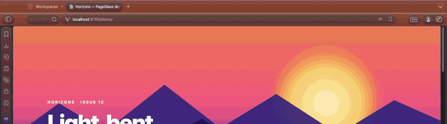
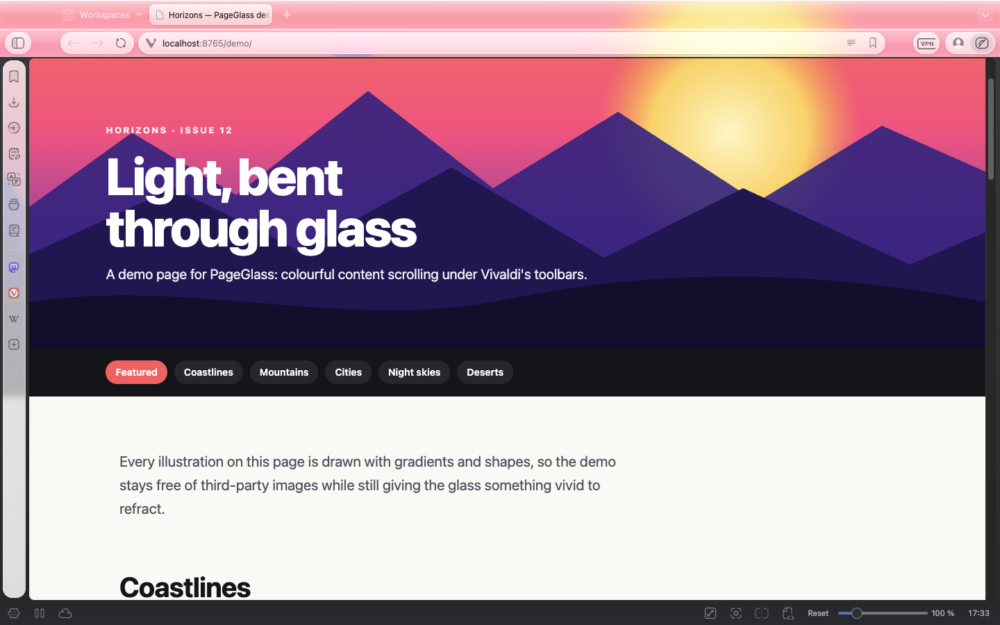
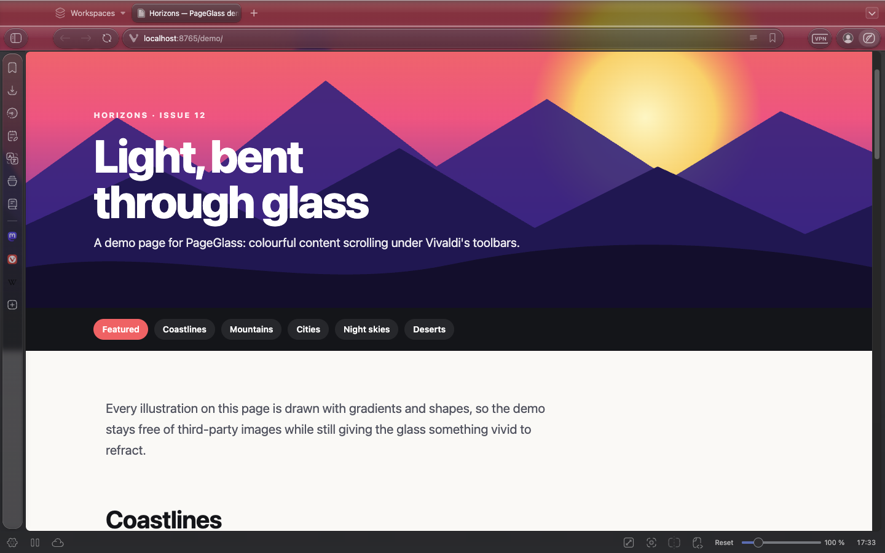
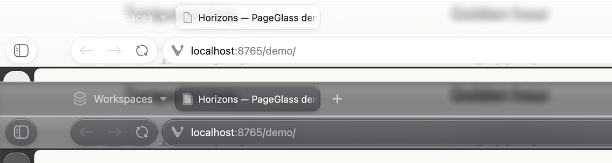

<h1 align="center">PageGlass</h1>

<p align="center">
  <b>A Liquid Glass look for the Vivaldi browser.</b><br>
  Frosted controls on a glossy bar that refracts and reflects the page you're reading — live, while you scroll.
</p>

<p align="center">
  <a href="LICENSE"></a>
  
  
  
</p>

<p align="center">
  
  <br><sub><a href="docs/demo.mp4">Full demo video (MP4, 30 s)</a> · <i>halfway through, PageGlass is switched off and on again to compare with stock Vivaldi</i></sub>
</p>

---

## Features

- **Glass that shows the page.** Vivaldi's toolbars display the tab underneath them, blurred and tinted, and follow it as you scroll.
- **Glossy bar, frosted controls.** The bar is clear with a lacquer-like highlight; buttons and the address field sit on top as milky frosted capsules, so icons stay readable over any colour.
- **Real reflections.** The bar that touches the page (top *or* bottom address bar) and the vertical strip beside it mirror the content right next to them.
- **Safari-style capsules.** Adjacent buttons (back · forward · reload) merge into one seamless capsule; spacers and dividers are left alone.
- **Floating sidebar.** Narrow strips (panel icons, vertical tabs) become an inset glass pane; wide panels become a floating card.
- **Follows your Mac.** Light and dark appearance, *Reduce motion* and *Reduce transparency* are respected.
- **Private by design.** Captures stay in memory, never on disk or on the network; internal pages and private windows are never captured.
- **One click to compare.** A PageGlass button at the end of the address bar turns the effect on and off, and remembers your choice.

| Light | Dark |
|---|---|
|  |  |

<p align="center"></p>

## Requirements

- **Vivaldi 8.x.** Developed and tested on Vivaldi 8.3 for macOS.
- **Python 3.8+** to run the installer (preinstalled on macOS and most Linux distributions).
- Linux and Windows are supported by the installer and the script is platform-independent, but they have **not been tested yet** — reports are welcome.

## Install

1. **Quit Vivaldi.**
2. Download the [latest release](../../releases/latest) and unzip it, or clone the repository:
   ```bash
   git clone https://github.com/halykoss/PageGlass.git && cd PageGlass
   ```
3. Run the installer:
   ```bash
   python3 pageglass.py install
   ```
4. Start Vivaldi.

The installer finds Vivaldi automatically. If yours lives somewhere unusual, point to it with `--vivaldi PATH` (the app, the install folder, or the folder containing `window.html`). Add `--dry-run` to see what would change without changing anything.

<details>
<summary><b>“Permission denied”?</b></summary>

- **macOS** protects apps in `/Applications`. Allow your terminal app under **System Settings → Privacy & Security → App Management**, then run the command again.
- **Linux**: Vivaldi is installed system-wide, so run the installer with `sudo`.
- **Windows**: open the terminal as Administrator if Vivaldi is installed for all users.
</details>

### After a Vivaldi update

Vivaldi updates replace the file PageGlass hooks into, so the effect disappears after an update. Just run `python3 pageglass.py install` again. `python3 pageglass.py status` tells you whether PageGlass is active and up to date.

### Uninstall

```bash
python3 pageglass.py uninstall
```

The installer saved an untouched copy of Vivaldi's `window.html` before changing it, and restores it byte for byte. If Vivaldi's file changed in the meantime, only the single line PageGlass added is removed. Backups live in `~/Library/Application Support/PageGlass` (macOS), `~/.local/share/PageGlass` (Linux) or `%APPDATA%\PageGlass` (Windows).

## Usage

- Click the **PageGlass button** (the little glass pane at the end of the address bar) to turn the effect off and on. Its tooltip shows the current state and how many captures were taken.
- The effect pauses on internal pages (`vivaldi://…`, settings, start page) and in private windows.

## How it works

Vivaldi's interface is itself a web page (`window.html`). PageGlass adds one script to it:

1. **Capture.** The visible tab is captured with Vivaldi's own thumbnail API (falling back to `tabs.captureVisibleTab`), at most every ~70 ms and only when something changes.
2. **Project.** The capture is laid under each toolbar as a texture: blurred and tinted for the bar, mirrored and compressed where a surface touches the page.
3. **Follow.** A tiny listener in `http(s)` pages reports *only the scroll position*. Between captures the texture is moved on the GPU (transforms only), so scrolling stays smooth.

Nothing is stored or transmitted: captures live in memory and are replaced by the next one. The page listener does not read page content.

## Customise

All colours and strengths are CSS variables at the top of the stylesheet in [`src/pageglass.js`](src/pageglass.js) (light values first, dark values in the `prefers-color-scheme: dark` block). The most useful ones:

| Variable | What it controls |
|---|---|
| `--pg-bar-tint` | How see-through the glossy bar is (higher alpha = more opaque) |
| `--pg-gloss`, `--pg-gloss-lo` | Strength of the lacquer highlight on the bar |
| `--pg-glass`, `--pg-glass-hi` | Fill of the frosted capsules (buttons, address field) |
| `--pg-tint` | Tint of the other glass surfaces |
| `--pg-strip-tint` | Tint of the vertical strip pane |
| `MIRROR` (JS constant) | How much the reflected page is compressed (default `0.45`) |

After editing, run `python3 pageglass.py install` again and restart Vivaldi.

## Limitations

- It is a **simulation from screenshots**, not native compositing: between two captures the toolbars can only move what has already been captured, so very fast scrolling can briefly re-align.
- Scrolling inside cross-origin iframes may not be detected.
- Modifying Vivaldi's UI files is unofficial. It is fully reversible, but Vivaldi updates undo it (see above).

## Development

```
src/pageglass.js        the mod itself (runs in Vivaldi's window)
pageglass.py            installer / uninstaller (standard library only)
demo/index.html         self-made demo page used for the recordings
tools/record-demo.mjs   records the demo from a throw-away Vivaldi profile via DevTools
tools/make-video.sh     turns the recorded frames into docs/demo.mp4 and docs/demo.gif
scripts/build-release.sh builds the release zip
```

To re-record the demo, see the comments at the top of [`tools/record-demo.mjs`](tools/record-demo.mjs). It uses a separate, empty Vivaldi profile and captures only Vivaldi's own window.

## License

[MIT](LICENSE) © 2026 Federico Pennino

PageGlass is an independent project, not affiliated with or endorsed by Vivaldi Technologies or Apple. “Liquid Glass” refers to the design language that inspired it.
